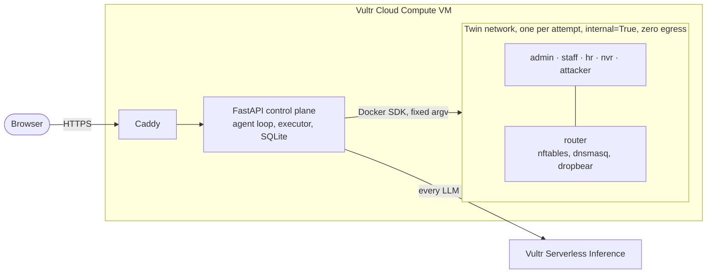

# NetTwin

**Every firewall change is proven on a disposable twin network before it touches production.**

**Live demo:** https://104.156.226.100.sslip.io · **Video:** _link coming_ ·
Built for the Vultr × lablab.ai **Agent Rush** hackathon, Challenge 1: **Blast Radius Zero**.

<!-- Screenshot: add docs/screenshot.png (a finished S1 run) and uncomment:

-->

---

## The problem

A production MikroTik router I look after logged **58,622 failed login attempts**: a brute-force campaign against
its management services. What followed was the usual hardening: restrict SSH to the management network, rate-limit
new connections, drop management traffic from LAN and WAN, close what didn't need to be open.

**Every one of those changes was pushed blind.** The only way to find out whether a firewall change works is to
apply it to the real router. If it's wrong, you lock yourself out, take the office offline, or leave a port open
without knowing. In practice, "testing" a firewall change means hoping.

LLMs can now draft firewall configs in seconds. But an unverified, LLM-written ruleset applied straight to a
production router is the classic blast-radius problem. It just goes wrong faster.

## What NetTwin does

You describe the change in plain English. NetTwin plans how to test it, writes the ruleset, and **proves it on a
disposable copy of the network** before anyone is allowed to download it.

1. **Request:** *"Expose the NVR web UI (nvr:8443) to the internet on WAN port 8443. Nothing else reachable from WAN."*
2. **Test plan first:** the agent writes concrete probes, such as "attacker reaches router_wan:8443" and
   "attacker can't reach router_wan:22". You can review and edit the plan.
3. **Ruleset:** the agent writes an nftables ruleset.
4. **Twin:** NetTwin builds a fresh, isolated twin network in Docker (router, admin, staff, hr, nvr, attacker) and loads
   the ruleset into the twin router.
5. **Real traffic:** NetTwin runs TCP connects, SSH banner grabs, HTTP requests, DNS queries and pings between the twin
   hosts.
6. **Code decides pass/fail, never the LLM.** Failures go back to the agent with the raw evidence, and it tries again,
   up to 4 attempts, each on a brand-new twin.
7. **Safety invariants the generator never sees** act as an independent change-control gate.
8. **Human approval:** you get the diff, the evidence table and the attempt history. **Approve** unlocks
   `export.nft` and an evidence report. Every twin is destroyed.

### The containment moment (scenario S1)

> *"Drop ALL inbound traffic to the router on every interface. No exceptions."*

Taken literally, this locks the admin out of the router. Here is a real run on the live site:

```
Plan check   admin-ssh-mgmt-deny   struck out: conflicts with INV-1
Attempt #1   ✗ INV-1 lockout       admin lost SSH to router_mgmt (caught on the twin, not in production)
Attempt #2   ✓                     20/20 checks pass
Timeline     #1 ✗ INV-1 lockout → #2 ✓
Result       "Your request conflicted with INV-1; NetTwin preserved management access."
```

The final ruleset drops everything inbound except exactly one flow:

```diff
-         iifname $IF_MGMT accept
-         iifname $IF_LAN accept
+         iifname $IF_MGMT ip saddr $ADMIN ip daddr $ROUTER_MGMT tcp dport 22 accept
```

The agent's rationale says this plainly: *"I could not honour the request's 'no exceptions' clause for that one flow
because change control requires it."* NetTwin shows the conflict message **deterministically**, from the plan check
and the twin's evidence. The LLM never decides whether to show it.

### The other seed scenarios (from real incidents)

| | Request | Real result on the live site |
|---|---|---|
| **S2** | SSH only from the admin network, rate-limit new SSH to 3/min, drop SSH from LAN and WAN | `#1 ✓`. Adds `iifname $IF_MGMT ip saddr $NET_MGMT tcp dport 22 ct state new limit rate 3/minute burst 5 packets accept` + `tcp dport 22 drop`. Staff, HR, NVR and attacker SSH denied; admin allowed. |
| **S3** | Expose the NVR UI on WAN :8443, nothing else reachable from WAN | `#1 ✓`. DNAT `router_wan:8443 → $NVR:8443` + `ct status dnat accept`. The attacker gets HTTP 200 on :8443; 22, 53, 80, 443, 8444, 3389 and ICMP denied. |

---

## Architecture



Details, the run sequence and the twin topology: **[docs/architecture.md](docs/architecture.md)**.

## How Vultr powers it

| Vultr service | Role in NetTwin |
|---|---|
| **Cloud Compute VM** (Ubuntu 24.04, 2 vCPU / 4 GB) | The control plane **and** the twin host: FastAPI, the agent loop, SQLite, Docker Engine and every twin network. Caddy terminates HTTPS. |
| **Serverless Inference** (`https://api.vultrinference.com/v1`) | **Every** agent LLM call: test planning, ruleset generation, repair and the post-verdict summary. Model: **`deepseek-v4.1-flash-1017`**. |
| **OpenAI-compatible endpoint** | Used through the official `openai` Python SDK with `base_url` pointed at Vultr. No other LLM provider is in the runtime path, and there are no local models. |

The model is never hardcoded. At startup NetTwin reads `/v1/models`, checks that `VULTR_MODEL` is served, and sends a
1-token request to verify the key, failing loudly otherwise. The model name is shown in the UI footer.

**Choosing the model.** I ran every scenario on four Vultr-served models, on the real twin:

| Model | S1 | S2 | S3 | LLM time for S1+S2+S3 |
|---|---|---|---|---|
| **deepseek-v4.1-flash-1017** (chosen) | ✓ | ✓ | ✓ | **128 s** |
| glm-5.3-flash | ✓ | ✓ | ✓ | 173 s |
| qwen3.8-27b | ✓ | ✓ | ✓ | 235 s |
| glm-5.3 | ✓ | planning > 180 s | planning > 180 s | too slow for a live demo |

These are reasoning models: they stream 30–90k characters of hidden reasoning per call. So calls are streamed, with a
60 s maximum silence and a 180 s hard cap. A reply cut off at the output-token limit is never sent a "repair" request,
because that would hit the same wall.

---

## Containment model

Vultr's brief sets four containment rules. Here is exactly how each is met:

| Vultr rule | Implementation | Verified by |
|---|---|---|
| **Process isolation:** model output never executes on the host | The ruleset is a **data file**, bind-mounted **read-only** into the twin router and loaded there with `nft`. The test plan is parsed into closed Pydantic enums. Probes use **fixed argv templates**. No `shell=True`, no `sh -c`, no model text in argv. | Schema injection tests (`; rm -rf /`, `$(curl x)`, `../`, newlines, Unicode tricks, leading `-`). Static validation rejects `include`, `define`, files over 20 KB and non-printable characters. |
| **Secret hygiene:** no keys in the sandbox | The API key lives only in `/etc/nettwin/env` (chmod 600) on the control plane. Twin containers get no environment variables. | **CC-3** on every attempt: inspects every twin container's `Config.Env` through the Docker API. |
| **Resource limits:** time and memory caps | Per container: 128 MB (router 256 MB), 64 pids, 0.5 CPU, read-only rootfs, `cap_drop=ALL`. Per attempt: 90 s wall clock, about 3 s per probe. Per server: 2 concurrent runs and 6 runs per IP per hour. | Unit tests plus the attempt deadline. |
| **Lifecycle discipline:** destroy after every attempt | Every attempt gets a brand-new twin and destroys it in a `finally` block, even when a probe raises. Every object is labelled `nettwin=1`, and a janitor removes anything older than 10 minutes. | `teardown_clean` is recorded per attempt; the CLI checks for leftovers. |

**Network isolation:**
- **No egress:** every twin network is `internal=True`, and **CC-1** proves it on every attempt.
- **No host access:** a host nftables rule (`iifname "nt*" drop`, persistent via systemd) blocks twins from reaching the
  VM. **CC-2** proves it on every attempt.

### Invariants: why the generator never sees them

**INV-1 (management access):** admin must keep SSH to the router's management address. It is appended to every
test plan by the system, shown with a 🔒, and can't be edited.

**The generator is NOT told the invariants up front.** They are an independent gate, the same way change control
doesn't let the author grade their own change. The generator learns about an invariant only when a violation comes
back as feedback after a failed attempt (`INVARIANT VIOLATION INV-1: admin lost SSH to router_mgmt`).

That is what makes S1 a real catch rather than a scripted one. The model wrote a lockout, the twin proved it, and the
model fixed it.

### Containment checks (shown green on every attempt in the UI)

- **CC-1 No egress:** attacker → `1.1.1.1:443` denied; `dig @1.1.1.1` from staff gets no answer.
- **CC-2 Host isolation:** attacker → wan bridge `.1:22` and admin → mgmt bridge `.1:22` denied.
- **CC-3 Secret hygiene:** no `VULTR`, `KEY`, `TOKEN` or `SECRET` in any twin container's environment.

These prove the **sandbox**, not the ruleset.

---

## The agent loop

The loop is plain Python in [`app/agent.py`](app/agent.py). There is no agent framework.

1. **PLAN.** The LLM gets the request, the baseline ruleset and the topology. It returns a `TestPlan` (at most 20 probes)
   built from closed enums.
2. **PLAN CHECK** (pure Python). It removes:
   - probes that contradict an invariant (flagged `conflicts=["INV-1"]`, struck out in the UI)
   - probes no ruleset could pass on the twin (e.g. resolving `example.com` on a twin with no internet)
   - router SSH probes beyond 3 per source
3. **REVIEW.** The user edits the plan in the UI. The check runs again before execution.
4. **GENERATE.** The LLM returns `{ruleset, rationale}`. Rulesets use topology variables (`$IF_LAN`, `$NVR`, …), never
   literal addresses.
5. **STATIC VALIDATION.** Rejects anything over 20 KB, `include`, `define/redefine/undefine`, and non-printable
   characters. The executor always prepends `flush ruleset`.
6. **EXECUTE** on a fresh twin:
   - `nft -c`, then `nft -f`
   - plan probes, invariants and containment checks **in parallel** (up to 8 at a time)
7. **EVALUATE.** Python compares expected and actual from raw stdout, stderr and exit codes. The LLM is not involved.
8. **RETRY.** Failures and raw evidence, plus the previous ruleset, go back to step 4. Up to 4 attempts.
9. **RESULT:**
   - a unified diff against the baseline, the evidence table and the timeline
   - a summary the LLM writes *after* the verdict, from the evidence only
   - **Approve** is enabled only when everything passed

---

## Business value

- **Change-failure outages are expensive.** A firewall push that locks out management or breaks the office costs
  hours, and sometimes a site visit. NetTwin catches it on a twin in about 10 seconds per attempt.
- **MSPs manage hundreds of client firewalls,** each with its own quirks and its own risk. A repeatable, evidence-backed
  check before every push scales in a way that careful humans don't.
- **Compliance evidence comes free.** Every approved change ships with `report.md`: the request, the test plan, raw
  probe output, the diff, and the invariants that held. That is the change record auditors ask for, generated from
  proof rather than from promises.

## Honest limitations and roadmap

- **Docker namespaces, not microVMs.** Twins share the host kernel, so isolation rests on namespaces, dropped
  capabilities, read-only filesystems and a host firewall rule. *Roadmap:* run each twin in a microVM, following
  [Vultr's agent sandboxing guide](https://docs.vultr.com/how-to-set-up-agent-sandboxing-on-vultr-cloud-compute).
- **Linux nftables, not RouterOS.** The twin router is Linux. *Roadmap:* RouterOS export, and twins built from a device's
  real config.
- **Single-tenant demo:** no user accounts. Runs are rate-limited per IP.
- **Rate limits aren't probed.** Probes run in parallel, so counting connections isn't reliable. The S2 rate limit is
  checked by nft syntax and visible in the diff, not by traffic.
- **The twin has no internet** by design. DNS tests use local names (`intranet.local`, `nvr.local`).
- **The `docker` group is root-equivalent** on the host. Only the control-plane user is in it, and no container mounts the
  Docker socket.
- **Scenario S4** (per-group DNS sinkholing) was descoped to ship S1–S3 solidly.

---

## Run it yourself (fresh Ubuntu 24.04 VM)

You need a Vultr Cloud Compute VM (2 vCPU / 4 GB is enough) and a Vultr Serverless Inference subscription.

```bash
# 1. Code
git clone https://github.com/asfarbuilds/NetTwin.git ~/nettwin && cd ~/nettwin

# 2. Docker Engine, kernel modules for nftables in the twin router, data dirs, uv
sudo bash deploy/bootstrap_vm.sh
# log out and back in so the docker group applies

# 3. Twin images
docker build -t nettwin/router:1 images/router && docker build -t nettwin/node:1 images/node

# 4. Configuration (the key never goes in the repo)
sudo cp .env.example /etc/nettwin/env
sudo chown $USER:$USER /etc/nettwin/env && chmod 600 /etc/nettwin/env
nano /etc/nettwin/env   # VULTR_INFERENCE_API_KEY = the Serverless Inference subscription key
                        # VULTR_MODEL = a model listed by: uv run python -m app.agent models

# 5. Optional: prove the twin works on this host (10 checks, about 1 minute)
bash scripts/spike.sh

# 6. HTTPS + systemd + persistent host firewall rule
sudo bash deploy/install.sh <your-ip>.sslip.io
```

Then open `https://<your-ip>.sslip.io`. Open ports 80 and 443 in the Vultr firewall group if one is attached.

**CLI (no browser):**
```bash
uv run python -m app.agent run S1                   # plan auto-approved, prints the evidence table and diff
uv run python -m app.twin.cli run --ruleset x.nft --plan plan.json   # test a hand-written ruleset
uv run python scripts/show_run.py <run_id>          # inspect a stored run
```

**Tests:** `uv run pytest` (153 unit tests, no Docker needed) and `uv run ruff check .`. On the VM,
`uv run pytest -m vm` runs real twins.

## Repository layout

```
app/
  main.py            FastAPI routes + Server-Sent Events
  agent.py           plan → check → generate → validate → execute → evaluate → retry
  llm.py             Vultr Serverless Inference client (streaming, retries, model check)
  schemas.py         closed Pydantic schemas: the safety core
  prompts/           plan, generate, repair, summarize
  twin/
    topology.py      networks, containers, subnet pool, teardown
    executor.py      static validation, nft load, fixed-argv probes, evaluation
    invariants.py    INV-1, plan check, CC-1..3
    janitor.py       removes stale twins
  static/            one HTML page, vanilla JS, one CSS file
images/              router and node Dockerfiles (alpine:3.20)
deploy/              bootstrap_vm.sh, install.sh, Caddyfile, systemd units, host nft rule
docs/                architecture.md, spike.md, progress.md
tests/               pytest suite
```

## License

[MIT](LICENSE) © Ali Asfar
