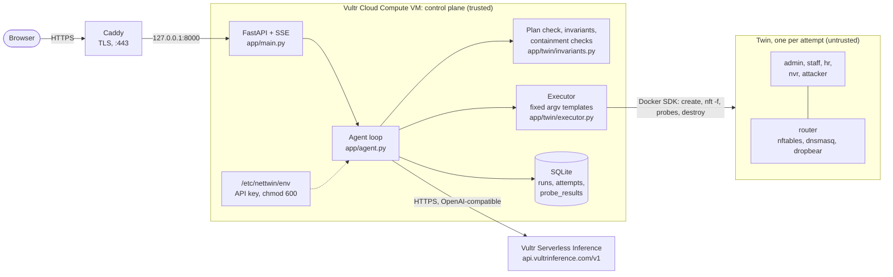
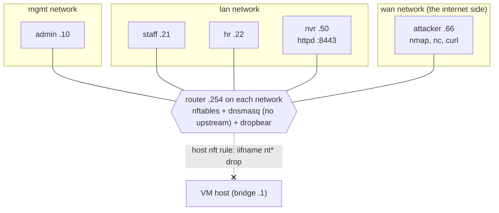

# NetTwin architecture

NetTwin is one Python process (FastAPI) on a Vultr Cloud Compute VM. It talks to two things: Vultr Serverless
Inference for every LLM call, and the local Docker Engine, which builds and destroys a twin network for every attempt.
Anything the model writes is treated as untrusted data.

## Components and trust boundaries



**Rules that hold across the boundary:**

- **Ruleset text:** the model's ruleset reaches the twin only as a **data file**. It is written on the host,
  bind-mounted **read-only** at `/etc/nettwin`, and loaded inside the twin router with `nft -f`.
- **Test plan:** the model's plan is parsed into a **closed Pydantic schema** (enums for nodes, targets, probe kinds
  and expectations). The model never supplies an IP address, a command or a flag.
- **Probes:** every probe runs from an argv list built from a fixed template, for example
  `["nc","-z","-w","3",IP,PORT]`. Nothing the model writes is put into a shell string or used as argv.
- **The API key** exists only in the control-plane environment. CC-3 checks every twin container's environment through
  the Docker API on every attempt.

## One run, end to end

```mermaid
sequenceDiagram
    autonumber
    participant U as User (browser)
    participant A as Agent (FastAPI)
    participant L as Vultr Serverless Inference
    participant T as Twin (fresh per attempt)

    U->>A: change request, e.g. "Drop ALL inbound traffic to the router"
    A->>L: PLAN: request + topology + baseline
    L-->>A: test plan JSON (Pydantic-validated)
    A->>A: plan check: strip probes that contradict an invariant<br/>or can never pass on the twin
    A-->>U: plan for review (editable; invariants locked)
    U->>A: Run on twin
    loop up to 4 attempts, each on a brand-new twin
        A->>L: GENERATE: request + plan (+ failures from the last attempt)
        L-->>A: {ruleset, rationale}
        A->>A: static validation (20 KB, no include/define, printable only)
        A->>T: create networks + containers, nft -c, nft -f
        A->>T: probes in parallel: plan + invariants + containment checks
        T-->>A: raw stdout, stderr, exit codes
        A->>A: evaluate in Python (no LLM)
        A->>T: destroy everything (finally block)
    end
    A->>L: SUMMARIZE: written after the verdict, from the evidence only
    A-->>U: timeline, evidence, containment panel, diff
    U->>A: Approve (only if everything passed)
    A-->>U: export.nft + report.md unlocked
```

## The twin

Every attempt gets three new Docker bridge networks with `internal=True`, so none of them has egress. Each gets a /24
from `10.231.0.0/16`, and its bridge is named `nt<id><m|l|w>`. The router sits at `.254` on each network, because
Docker gives `.1` to the host bridge.



**Container limits (every container):**
- `cap_drop=ALL`, read-only root filesystem with tmpfs `/tmp` and `/run`, `no-new-privileges`
- 64 pids, 0.5 CPU, 128 MB memory (router 256 MB)
- no environment variables, no host network, no Docker socket, never privileged

**Router extras:** it adds only `NET_ADMIN` (nftables and forwarding) and `NET_BIND_SERVICE` (dnsmasq on 53,
dropbear on 22).

**Node routing:** each node's default route is pointed at the router once, at setup, before any model output exists.

**Topology variables.** Subnets change on every attempt, so rulesets never contain literal addresses. The executor
prepends `flush ruleset` plus `define`s for `$IF_MGMT/$IF_LAN/$IF_WAN`, `$NET_*`, `$ROUTER_*` and
`$ADMIN/$STAFF/$HR/$NVR/$ATTACKER`. The export replaces them with `CHANGE_ME` placeholders, so `nft` refuses the
file until the engineer fills in production values.

## Checks that are not the model's to decide

| Check | What | Why |
|---|---|---|
| **INV-1** | admin → router_mgmt SSH banner must be **allowed** | Change control: never lock the admin out. Hidden from the generator. |
| **CC-1** | attacker → `1.1.1.1:443` denied; `dig @1.1.1.1` from staff gets no answer | The twin has zero egress. |
| **CC-2** | attacker → wan bridge `.1:22` and admin → mgmt bridge `.1:22` denied | Twins can't reach the host. |
| **CC-3** | no `VULTR`, `KEY`, `TOKEN` or `SECRET` in any twin container's environment (Docker API) | No secrets in the sandbox. |
| **Plan check** | removes probes that contradict an invariant, or that no ruleset could pass on the twin | Otherwise S1 could never pass, and the generator would chase impossible tests. |

## Host side

- **`nettwin.service`:** runs uvicorn on `127.0.0.1:8000` with `--proxy-headers --forwarded-allow-ips=127.0.0.1`,
  so the per-IP rate limit sees real client addresses from Caddy. `Restart=always`.
- **`nettwin-host.service`:** loads `table inet nettwin_host { chain input { … iifname "nt*" drop } }` at boot and
  again whenever Docker restarts. It only touches its own table and never runs `flush ruleset`.
- **Caddy:** automatic HTTPS for `104.156.226.100.sslip.io`, with SSE passed through unbuffered.
- **Janitor:** on startup and every 5 minutes, removes any Docker object labelled `nettwin=1` that is older than
  10 minutes.
